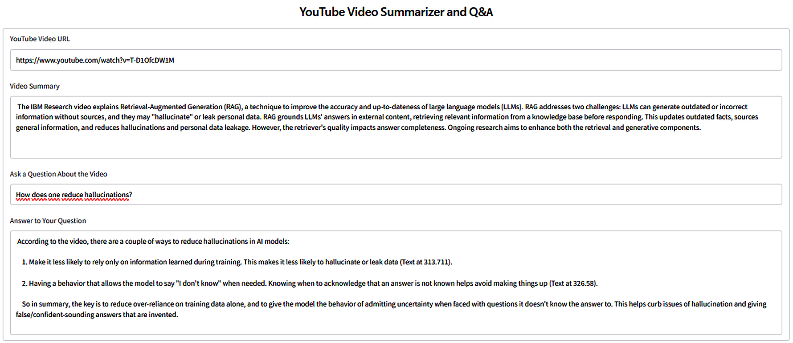
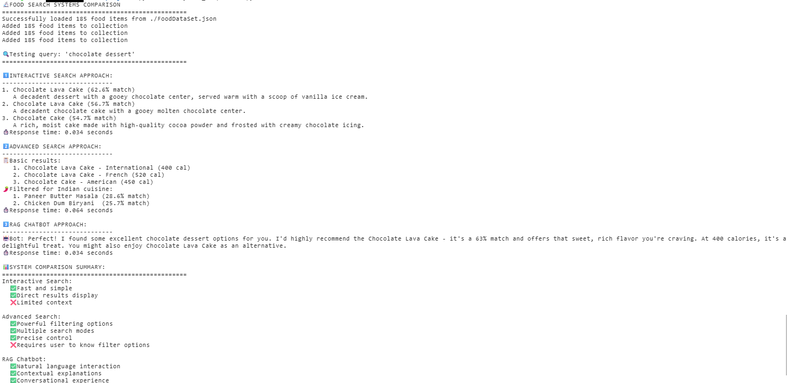
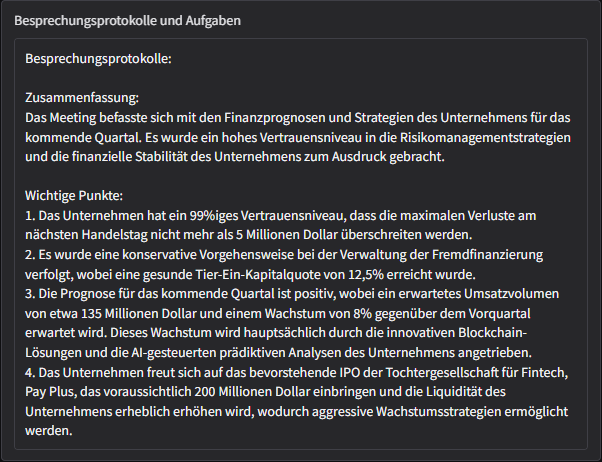
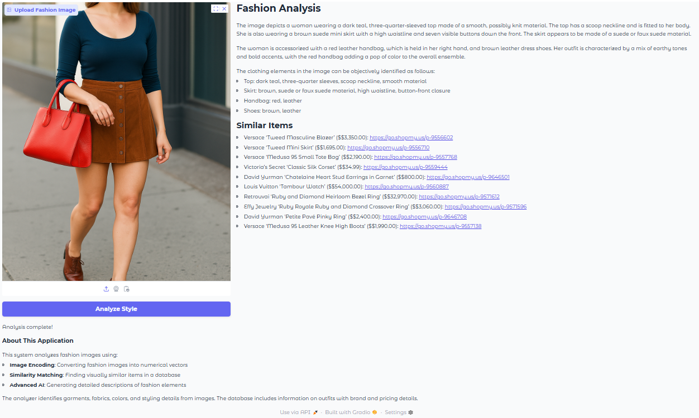
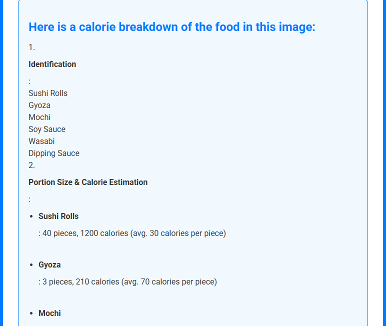

# IBM RAG & Agentic AI — Project Portfolio

Applications I built while completing the [IBM RAG and Agentic AI Professional Certificate](https://www.coursera.org/professional-certificates/ibm-rag-and-agentic-ai) on Coursera: retrieval-augmented generation (RAG), vector databases, multimodal generative AI and AI agents, built with LangChain, LlamaIndex, ChromaDB, FAISS and IBM watsonx.ai.

The first four courses are also certified as the specialization [RAG for Generative AI Applications](https://coursera.org/verify/specialization/2B5H65S6YI0B).

## Highlights

| | Project | What it does |
|---|---|---|
|  | **[YouTube Summarizer & Q&A](courses/04-advanced-rag-retrievers/README.md)** | Gradio app that summarizes any YouTube video and answers questions about it. Transcript chunks are embedded into FAISS and only the most relevant ones are passed to the LLM. Also answers questions asked in German about English videos. |
|  | **[Food Recommendation RAG Chatbot](courses/03-vector-databases-for-rag/README.md)** | Three search systems on one ChromaDB core (~185 dishes): semantic search, metadata-filtered search and a RAG chatbot that recommends dishes with IBM Granite. |
|  | **[AI Meeting Assistant](courses/05-multimodal-generative-ai/README.md)** | Turns a meeting recording into minutes and a task list: Whisper transcription, an LLM pass that normalizes financial terminology, then structured minutes. |
|  | **[Fashion Style Finder](courses/05-multimodal-generative-ai/README.md)** | Multimodal RAG: an outfit photo is embedded with ResNet50, matched against a fashion catalog by cosine similarity, and described by a vision-language model (Llama 4). |
|  | **[AI Nutrition Coach](courses/05-multimodal-generative-ai/README.md)** | Flask web app that identifies the food in a photo and estimates portions, calories and nutrients with a vision-language model. |

## Skills

- **LLM applications:** prompt engineering (few-shot, chain-of-thought), prompt templates, output parsers with Pydantic schemas, LCEL chains, model comparison (Granite, Llama, Mistral, GPT)
- **RAG:** document parsing (Docling), loading and chunking, embeddings, retrievers (MMR, multi-query, self-query, parent document, BM25, query fusion), grounded prompts
- **Vector databases:** ChromaDB collections with metadata filters, FAISS indexes, cosine / L2 / dot-product similarity
- **Multimodal AI:** speech-to-text (Whisper), text-to-speech (gTTS), image generation, image captioning and visual Q&A, multimodal RAG with image embeddings
- **AI agents:** tool calling with LangChain (`@tool`, `bind_tools`, `create_agent`), hand-written and recursive tool loops, LCEL chains, pandas DataFrame and SQL agents, built-in tools (Wikipedia, YouTube)
- **Agentic workflows:** LangGraph state graphs with nodes, conditional edges and loops; workflow patterns (prompt chaining, routing, parallelization, orchestrator-worker, evaluator-optimizer); self-improving reflection agents; multi-agent RAG with relevance checking and answer verification
- **Delivery:** Gradio and Flask web apps, structured JSON responses

## Course progress

Legend: 🟢 Done · 🟡 In progress · ⚪ Not started

| # | Course | Status |
|---|---|---|
| 1 | [Develop Generative AI Applications: Get Started](courses/01-generative-ai-get-started/README.md) | 🟢 Done |
| 2 | [Build RAG Applications: Get Started](courses/02-build-rag-applications/README.md) | 🟢 Done |
| 3 | [Vector Databases for RAG: An Introduction](courses/03-vector-databases-for-rag/README.md) | 🟢 Done |
| 4 | [Advanced RAG with Vector Databases and Retrievers](courses/04-advanced-rag-retrievers/README.md) | 🟢 Done |
| 5 | [Build Multimodal Generative AI Applications](courses/05-multimodal-generative-ai/README.md) | 🟢 Done |
| 6 | [Fundamentals of Building AI Agents](courses/06-building-ai-agents/README.md) | 🟢 Done |
| 7 | [Agentic AI with LangChain and LangGraph](courses/07-agentic-ai-langchain-langgraph/README.md) | 🟢 Done |
| 8 | [Agentic AI with LangGraph, CrewAI, AutoGen and BeeAI](courses/08-multi-agent-frameworks/README.md) | 🟡 In progress (~20%) |
| 9 | [Build AI Agents using MCP](courses/09-ai-agents-mcp/README.md) | ⚪ Not started |
| 10 | [RAG and Agentic AI Capstone Project](courses/10-capstone-project/README.md) | ⚪ Not started |

## About the code

In line with the Coursera Honor Code, lab solutions and course materials are kept in a private repository. I'm happy to walk through the code in an interview.

## About me

**Zidane Kenfack Fouape** — Bremen, Germany

- Master Informatik – Vertrauenswürdige Systeme (Hochschule Bremerhaven): all modules completed, chose direct career entry
- Working student at Beezubi Lernwelt GmbH: AI-powered data pipelines and a learning app
- GitHub: [github.com/danezi](https://github.com/danezi)
- LinkedIn: [linkedin.com/in/zidane-kenfack-fouape-651421222](https://www.linkedin.com/in/zidane-kenfack-fouape-651421222/)

## License

My texts, diagrams and screenshots are released under the [MIT License](LICENSE). Course content from IBM and Coursera (instructions, notebooks, datasets, solutions) is not included in this repository.
