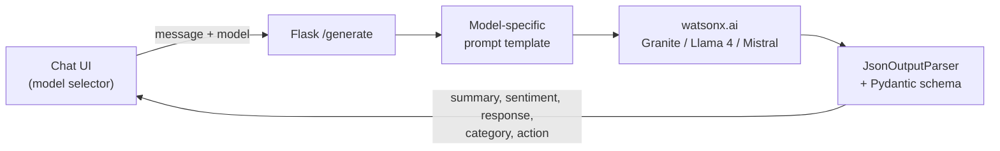
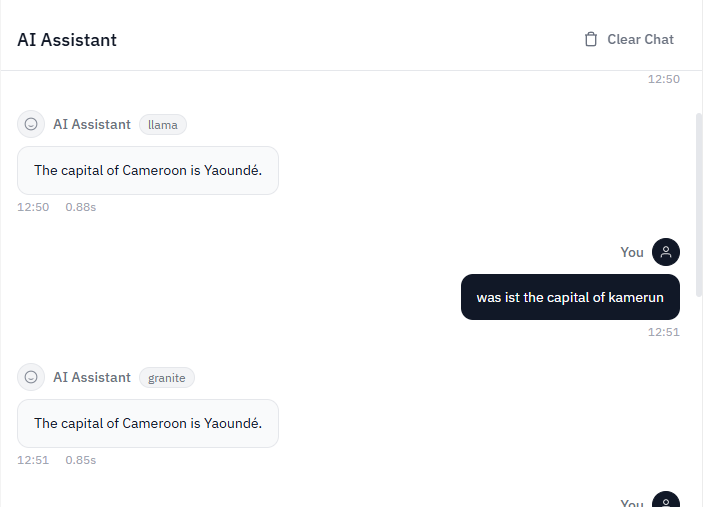

# 01 · Develop Generative AI Applications: Get Started

[Course on Coursera](https://www.coursera.org/learn/develop-generative-ai-applications-get-started) · Status: 🟢 Done

## What I built

A customer-support "AI Assistant" web app in Flask that returns validated JSON instead of free text, so other code can use the answers directly. The same chat UI can switch between three watsonx.ai models (Granite, Llama 4, Mistral Small) to compare them side by side. Before that, I worked through prompt engineering techniques and the core LangChain building blocks in two labs.

## Architecture

## Projects & labs

| Project | What it does | Key techniques | Stack |
|---|---|---|---|
| Prompt engineering lab | Compares prompting styles on the same tasks (summarization, QA, classification, code generation, role play) | Zero/one/few-shot, chain-of-thought, self-consistency, `PromptTemplate` | LangChain, Granite 4 |
| LangChain building blocks lab | Combines LangChain components into a RAG pipeline, a chatbot with memory and a tool-using agent | Output parsers, Chroma retrieval, conversation memory, LCEL vs. legacy chains, ReAct agent | LangChain, Chroma, Granite, Llama 4 |
| **AI Assistant (final project)** | Support chatbot returning structured JSON, with a model selector for comparison | Pydantic output schema, `JsonOutputParser`, per-model prompt formats | Flask, LangChain, watsonx.ai |

## Results

*The same question answered by two models in the AI Assistant, each with its response time.*

## Key learnings

- Prompt structure matters more than parameter tuning: few-shot examples fix the output format, chain-of-thought improves multi-step reasoning.
- A Pydantic schema enforced by an output parser turns an LLM reply into data that downstream code can rely on.
- Each model family expects its own prompt format (special tokens, message layout); one template for all models gives inconsistent results.
- LCEL (`prompt | llm | parser`) is the current way to compose LangChain chains; it makes swapping models or prompts a one-line change.
