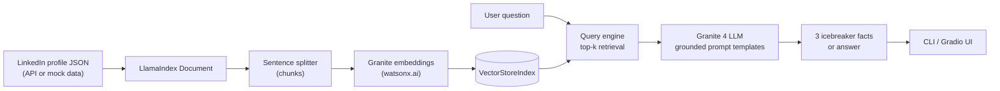

# 02 · Build RAG Applications: Get Started

[Course on Coursera](https://www.coursera.org/learn/build-rag-applications-get-started) · Status: 🟢 Done

## What I built

The "Icebreaker Bot": a small end-to-end RAG application that indexes one LinkedIn profile and answers questions only from that profile's data. It opens with three interesting facts about the person, then lets you chat about their career and education. It runs as a CLI and as a Gradio web app, and works with a mock profile when no API key is available.

## Architecture

## Projects & labs

| Project | What it does | Key techniques | Stack |
|---|---|---|---|
| **Icebreaker Bot (final project)** | Generates conversation starters and answers questions about a LinkedIn profile | Chunking, vector index, top-k retrieval, two grounded prompt templates ("answer only from context, otherwise say you don't know"), session-scoped indexes | LlamaIndex, IBM watsonx.ai (Granite 4, Granite embeddings), Gradio |

## Results

Screenshots of this project are not published because they show the profile data of a real person (the mock profile provided in the lab).

## Key learnings

- LlamaIndex covers the same RAG pipeline as LangChain (load, split, embed, index, retrieve, prompt) with fewer calls: `VectorStoreIndex` plus a query engine.
- Retrieval alone does not stop hallucinations; the prompt must also tell the model to answer only from the retrieved context and admit when it doesn't know.
- A mock-data fallback makes a RAG app testable without paid API keys or network access.
- Scoping each index to a user session keeps several processed profiles from mixing in the web app.
