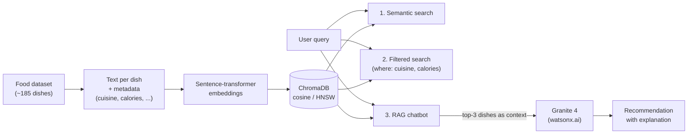
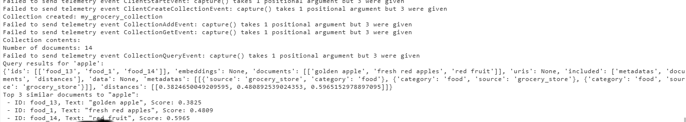
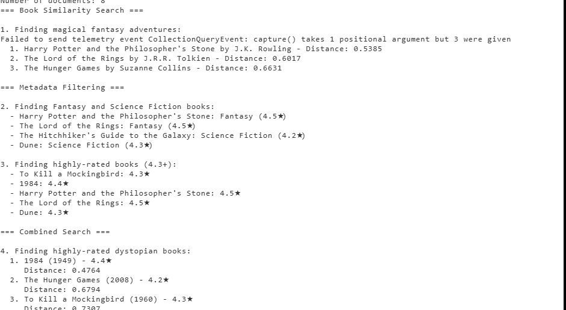

# 03 · Vector Databases for RAG: An Introduction

[Course on Coursera](https://www.coursera.org/learn/vector-databases-for-rag-an-introduction) · Status: 🟢 Done

## What I built

I started by computing similarity metrics by hand, then moved to ChromaDB for semantic search with metadata filters. The final project is a food recommendation system with three interfaces on one shared ChromaDB core: plain semantic search, filtered search, and a RAG chatbot that lets IBM Granite recommend and explain dishes based on the retrieved results.

## Architecture

## Projects & labs

| Project | What it does | Key techniques | Stack |
|---|---|---|---|
| Similarity search by hand | Computes L2 distance, dot product and cosine similarity manually and retrieves the best document for a query | Vector normalization, matrix operations, `argmax` retrieval | NumPy, SciPy, PyTorch, sentence-transformers |
| ChromaDB similarity search | Stores grocery items in a collection and finds the closest matches for "apple" | Embedding function, cosine distance (HNSW) | ChromaDB |
| Employee & book search | Semantic search combined with metadata filters on structured records | `where` filters (`$gte`, `$in`, `$and`) combined with similarity queries | ChromaDB |
| **Food recommendation system (final project)** | Three search systems on one shared core, compared side by side | Shared retrieval module, filtered search, RAG with fallback answers, top-k analysis | ChromaDB, IBM watsonx.ai (Granite 4) |

## Results

*Semantic search for "apple": the three closest items with their cosine distances.*

*Similarity search, metadata filtering and a combined query on a book dataset.*

*The same query run through all three systems, with response times and a capability summary.*

## Key learnings

- Cosine similarity compares only the direction of vectors, which is why it is the default for semantic search; L2 and dot product also depend on vector length.
- Embeddings answer "what is similar", metadata filters answer "what meets an exact condition" (a range, a category). One query can combine both.
- In RAG, the LLM only sees the retrieved results, which keeps its recommendations grounded in the real dataset.
- Top-k is a real tuning parameter: each additional result is, by construction, less similar to the query.
