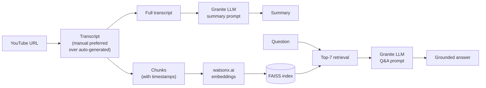
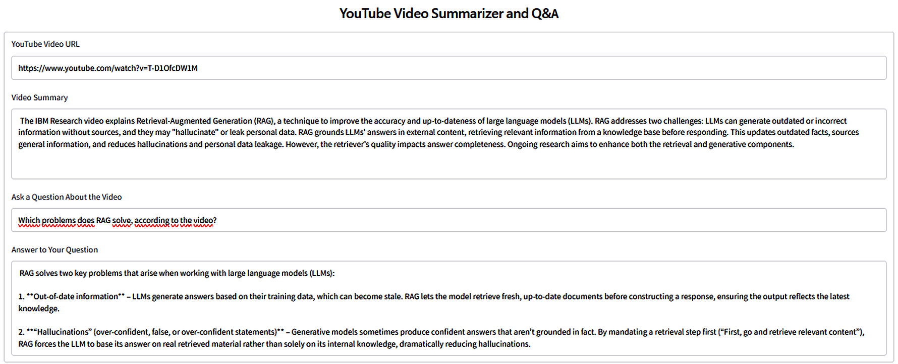
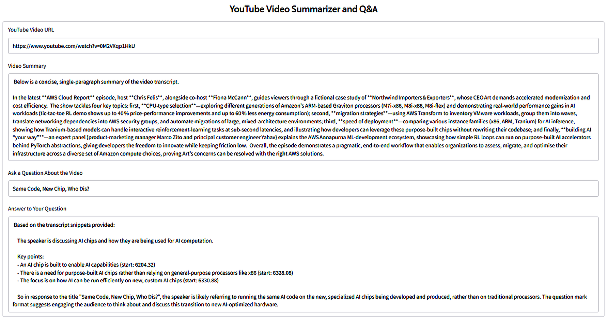
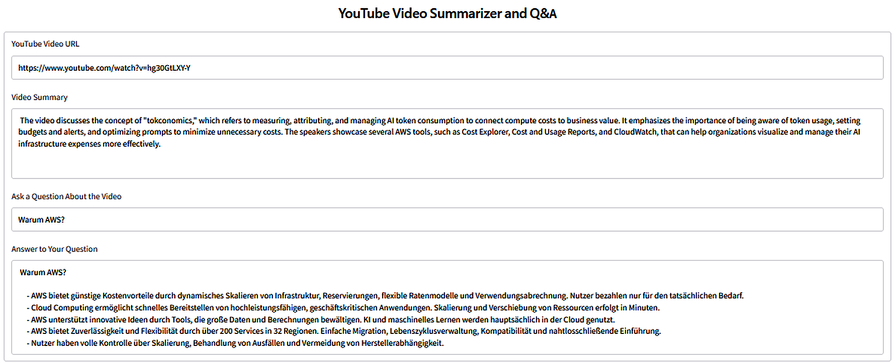

# 04 · Advanced RAG with Vector Databases and Retrievers

[Course on Coursera](https://www.coursera.org/learn/advanced-rag-with-vector-databases-and-retrievers) · Status: 🟢 Done

## What I built

A Gradio app that summarizes any YouTube video and answers free-form questions about its content. Summaries use the full transcript; questions use retrieval over transcript chunks stored in FAISS, so answers stay grounded in the video. Beyond the lab's test video, I tested it on two other videos, including a question asked in German about an English video. In the labs before, I compared advanced retriever types in LangChain and LlamaIndex and built a semantic search engine directly on FAISS.

## Architecture

## Projects & labs

| Project | What it does | Key techniques | Stack |
|---|---|---|---|
| Smarter search with LangChain | Compares four retriever types on a policy document, a PDF and a movie dataset | MMR, similarity threshold, multi-query, self-query (LLM-generated metadata filters), parent document | LangChain, Chroma, watsonx.ai |
| Advanced retrievers in LlamaIndex | Six retriever types on one corpus, plus a custom hybrid retriever | BM25, document summary index, auto-merging, recursive, query fusion (RRF, relative score, distribution-based) | LlamaIndex, Granite 4, BGE embeddings |
| Semantic search with FAISS | Search engine over ~20,000 newsgroup posts without a framework | Text cleaning, Universal Sentence Encoder, exact L2 index | FAISS, TensorFlow Hub |
| **YouTube Summarizer & Q&A (final project)** | Summarizes videos and answers questions about them | Separate summarization and RAG paths, chunking, FAISS retrieval, two prompt chains | LangChain, FAISS, watsonx.ai, Gradio |

## Results

*Lab test video: summary and a grounded answer with transcript timestamps.*

*Second question on the same video.*

*My own test: a different video about AI chips.*

*A question asked in German about an English video, answered in German from the transcript.*

## Key learnings

- Each advanced retriever fixes a specific weakness of plain similarity search: MMR avoids near-duplicate results, multi-query reduces sensitivity to wording, parent-document retrieval balances precise chunks with enough context.
- LangChain and LlamaIndex implement the same ideas under different names (parent document ≈ auto-merging, multi-query ≈ query fusion).
- When combining two retrievers, node IDs are not comparable; results must be matched on content.
- Not every task needs retrieval: a summary can consume the whole transcript, while Q&A works better with only the relevant chunks.
- Queries must be preprocessed exactly like the indexed documents, otherwise they land in a different part of the embedding space.
