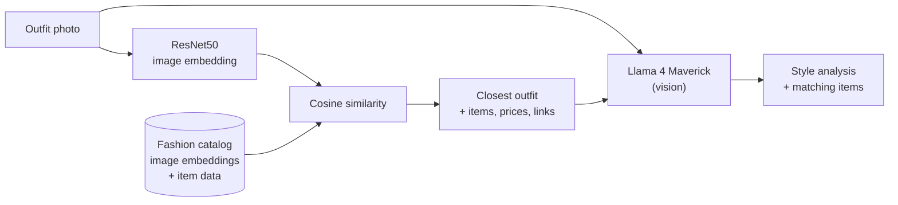
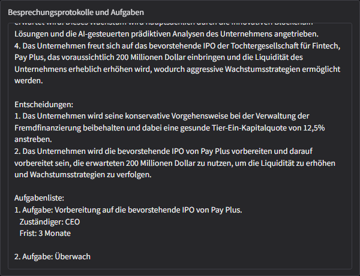
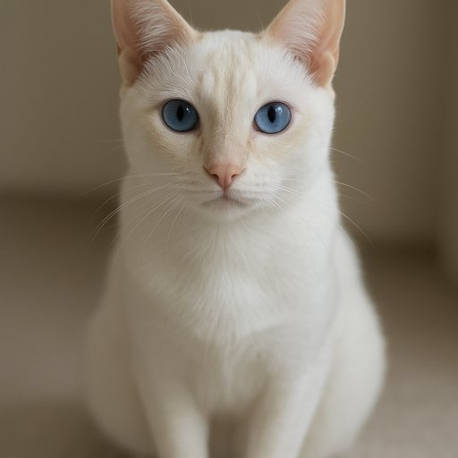
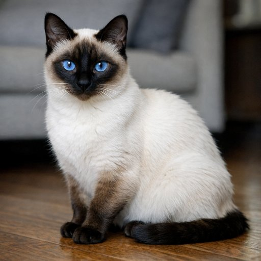
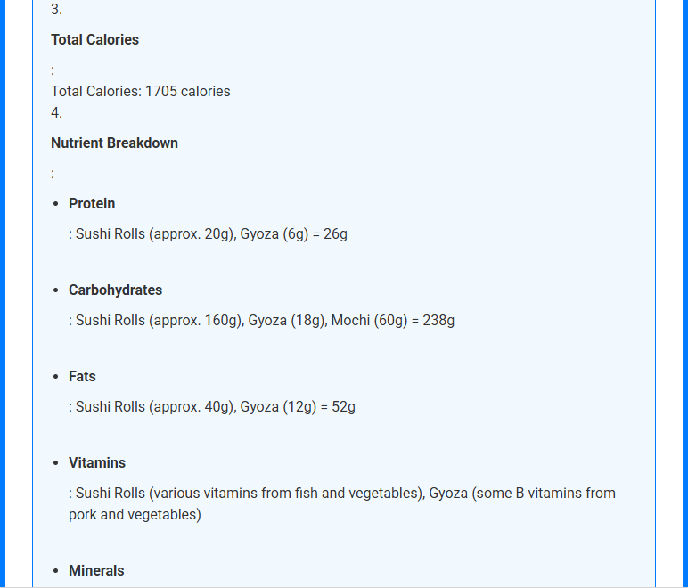
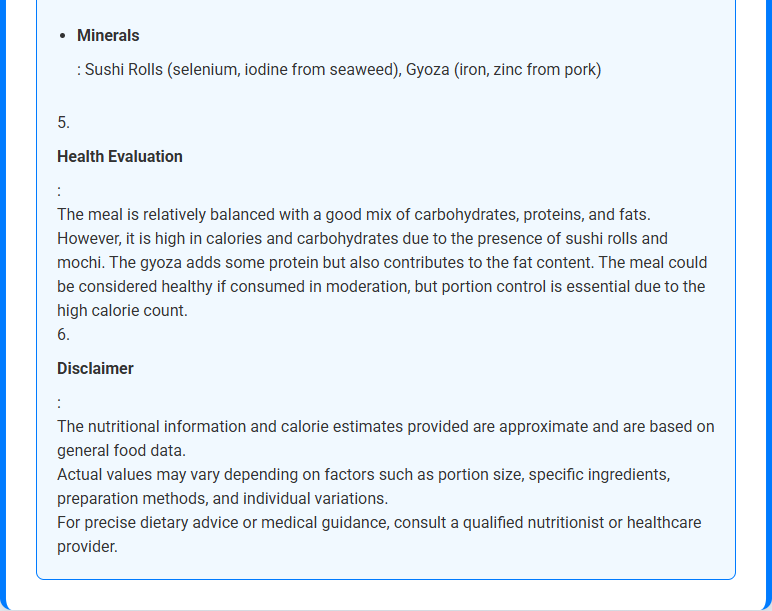
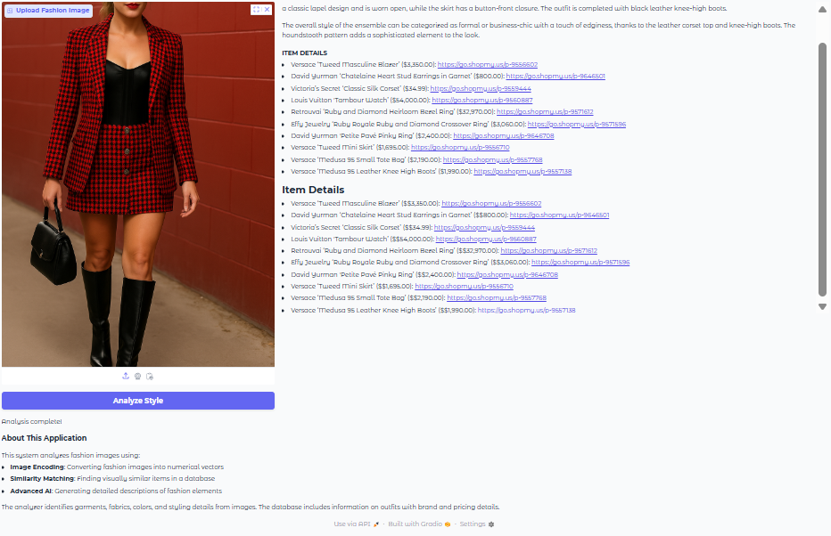
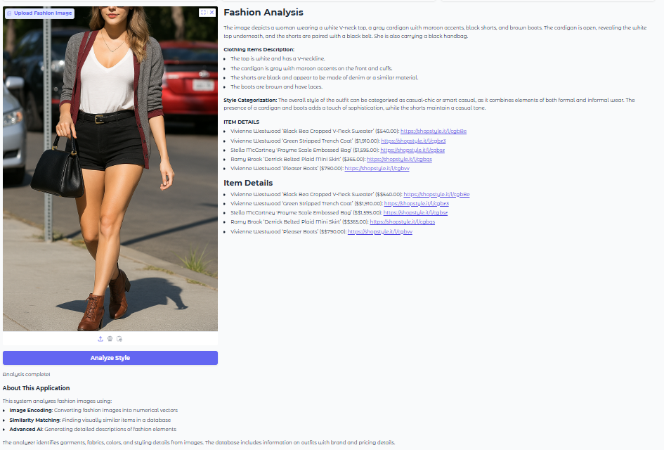

# 05 · Build Multimodal Generative AI Applications

[Course on Coursera](https://www.coursera.org/learn/build-multimodal-generative-ai-applications) · Status: 🟡 In progress (~90%)

## What I built

Applications that combine text with speech and images. An AI Meeting Assistant turns a recording into minutes and a task list. A Fashion Style Finder uses multimodal RAG to match an outfit photo against a fashion catalog. An AI Nutrition Coach estimates calories and nutrients from a food photo. Smaller labs covered text-to-speech storytelling, image generation and image captioning with a vision-language model.

## Architecture

**AI Meeting Assistant**

**Fashion Style Finder (multimodal RAG)**

## Projects & labs

| Project | What it does | Key techniques | Stack |
|---|---|---|---|
| Personal storyteller | Writes a short educational story on any topic and reads it aloud | Constrained story prompt, text-to-speech, inline audio player | watsonx.ai (Mistral Medium), gTTS |
| **AI Meeting Assistant** | Meeting recording → minutes and task list, downloadable as text | Speech-to-text, LLM terminology normalization, two-step LLM pipeline | Whisper (Hugging Face), Granite 4, LangChain, Gradio |
| Image generation | Generates images from text prompts and compares a small and a large model | Text-to-image API, model comparison | OpenAI Images API (`gpt-image-1-mini`, `gpt-image-1.5`) |
| Image captioning & visual Q&A | Describes images and answers questions about them (counting, damage assessment, nutrition labels) | Base64 image input in chat messages | watsonx.ai (Llama 4 Maverick) |
| **AI Nutrition Coach** | Food photo → identified items, portions, calories, nutrients, health evaluation | Vision-language prompting with a structured output format | Flask, Llama 4 Maverick |
| **Fashion Style Finder** | Outfit photo → style analysis and similar catalog items with prices | Image embeddings, similarity search, retrieval-augmented generation | PyTorch (ResNet50), scikit-learn, Llama 4 Maverick, Gradio |

## Results

**AI Meeting Assistant** (viewed with the browser's German page translation)

*Summary and key points extracted from a 56-second earnings-call recording.*

*Decisions and task list. Another run of the same recording reported assignee and deadline as "not specified"; see key learnings.*

**Image generation:** "a white siamese cat" and "a beautiful lake with a sunset"

| gpt-image-1-mini | gpt-image-1.5 |
|---|---|
|  |  |
|  |  |

**AI Nutrition Coach** (test image: a sushi platter)

*Identified items with estimated portions and calories.*

*Total calories and nutrient breakdown.*

*Health evaluation and disclaimer.*

**Fashion Style Finder**

*Houndstooth outfit: style analysis and items from the closest catalog outfit.*

*Cardigan outfit: clothing description and style categorization.*

*Teal top outfit: accurate description, but the retrieved items are the same as for the houndstooth outfit.*

## Key learnings

- A dedicated low-temperature LLM pass that only fixes terminology gives the summarization step a cleaner input than one prompt doing both jobs.
- Sampling-based decoding makes structured extraction unreliable: the same recording produced different decisions in two runs, and only one of them named an assignee and a deadline. Greedy decoding or an explicit "write *not specified*" rule is safer for task lists.
- Vision-language models handle captioning, visual Q&A and reading text in images with the same call; only the question changes.
- Estimates from images are rough: the Nutrition Coach counted 40 sushi pieces on a platter that clearly holds more.
- Multimodal RAG is only as good as its catalog: two different outfits matched the same closest catalog entry and returned identical items.
