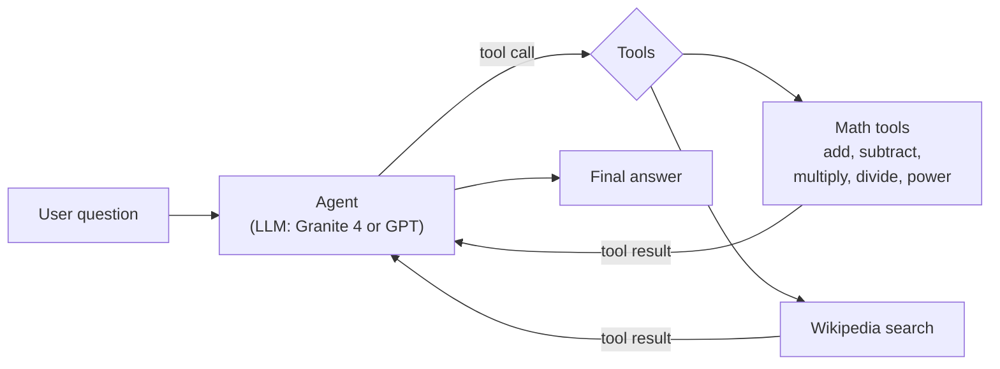

# 06 · Fundamentals of Building AI Agents

[Course on Coursera](https://www.coursera.org/learn/fundamentals-of-building-ai-agents) · Status: 🟡 In progress (~15%)

## What I built

A math assistant agent that decides on its own which tool to call: add, subtract, multiply, divide and a power tool. I then extended it with a Wikipedia search tool, so it can answer multi-step questions that need both a lookup and a calculation (for example, the population of Canada multiplied by 0.75).

## Architecture

## Projects & labs

| Project | What it does | Key techniques | Stack |
|---|---|---|---|
| **AI Math Assistant** | Agent that solves arithmetic and lookup questions by calling tools | Tools via `Tool` class and `@tool` decorator, typed multi-input tools, `create_agent`, automated test cases, built-in Wikipedia tool | LangChain, watsonx.ai (Granite 4), OpenAI (GPT-5.4 nano) |

## Results

- 4 of 4 automated test cases passed (sequential subtraction, multiplication, division, negative results) after fixing the subtraction tool.
- Multi-step question answered correctly: Wikipedia lookup of Canada's population, then a multiplication tool call.
- Exercise: a custom power tool, "5 to the power of 2" → 25.

## Key learnings

- An agent is only as reliable as its tools: a first addition tool silently dropped decimals and returned 0, while the LLM still answered correctly on its own. Inspecting the tool messages, not only the final answer, reveals this.
- The `@tool` decorator builds the argument schema from type hints and the docstring; clear names and descriptions help the model pick the right tool.
- Tools should be tested directly before an agent uses them, and agent behavior should be checked with automated test cases.
- Search tools need precise queries: a Wikipedia search for "tool calling" returned an article about cold calling.
