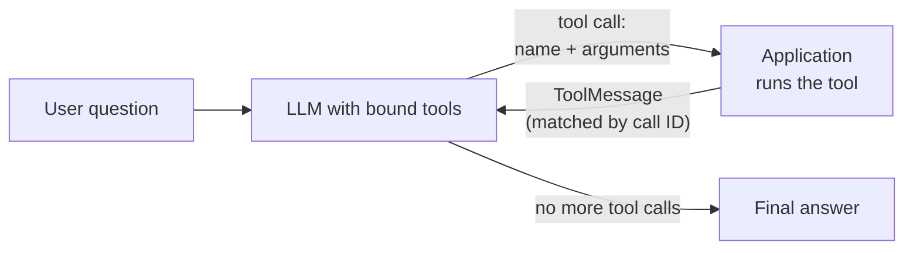
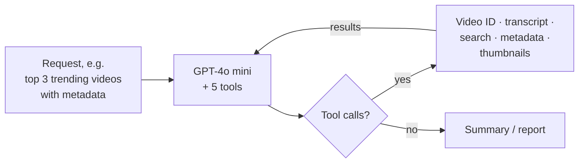
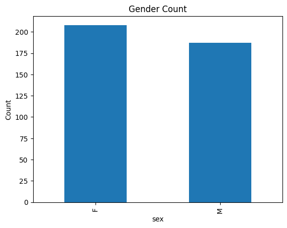
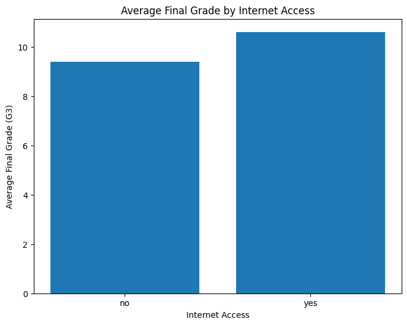
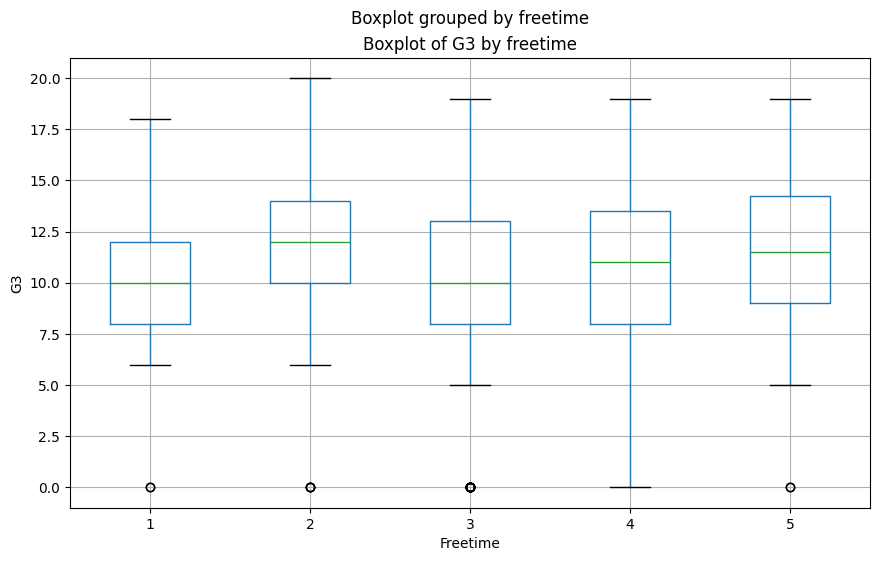
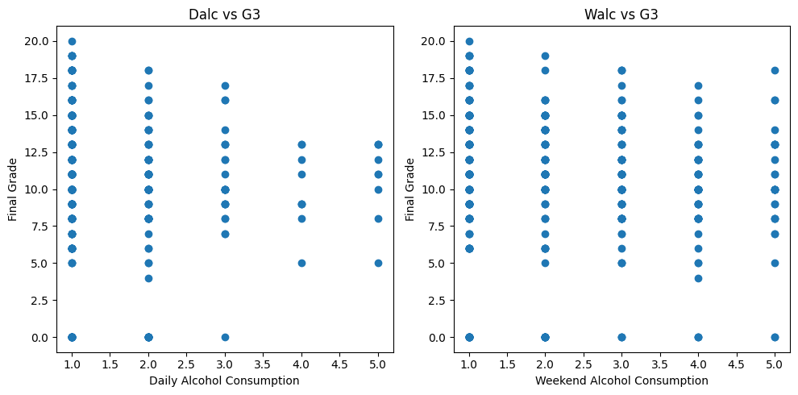

# 06 · Fundamentals of Building AI Agents

[Course on Coursera](https://www.coursera.org/learn/fundamentals-of-building-ai-agents) · Status: 🟢 Done

## What I built

A series of tool-calling agents, from a hand-written agent loop to LangChain's built-in agents. They include a math assistant with a Wikipedia lookup, a YouTube agent that finds, analyzes and summarizes videos through five tools, a visualization agent that turns plain-English requests into charts, and a SQL agent that answers questions about a MySQL database. Along the way I implemented the tool-calling loop by hand to understand what an agent framework does internally.

## Architecture

**Tool-calling loop** (used by all agents in this course)

**YouTube agent** (recursive chain)

## Projects & labs

| Project | What it does | Key techniques | Stack |
|---|---|---|---|
| AI Math Assistant | Solves arithmetic and lookup questions by calling tools | `Tool` class vs. `@tool`, typed multi-input tools, `create_agent`, automated test cases, Wikipedia tool | LangChain, Granite 4, GPT-5.4 nano |
| DataWizard | Agent tools to explore CSV files and train baseline models | Single-purpose tools, in-memory dataset cache, `AgentExecutor` (ReAct) | LangChain, pandas, scikit-learn, GPT-4o mini |
| Interactive tool agent | Runs the tool-calling loop by hand, then wraps it in an agent class; tip calculator agent | `bind_tools`, tool calls, `ToolMessage`, chat history | LangChain, GPT-4o mini |
| **YouTube agent** | Finds videos, collects metadata, transcripts and thumbnails, writes summaries | Five custom tools, two-step LCEL chain, recursive tool loop | LangChain (LCEL), youtube-transcript-api, yt-dlp, GPT-4o mini |
| **Data visualization agent** | Answers questions and draws charts from plain-English requests | pandas DataFrame agent, checking the generated code in intermediate steps | LangChain, Llama 4 Maverick (watsonx.ai), pandas, matplotlib |
| **Natural language SQL agent** | Answers questions about a music-store database (Chinook) | `create_sql_agent` (ReAct), schema inspection, low temperature for stable SQL | LangChain, Granite 4, MySQL |

## Results

**Math assistant:** 4 of 4 automated test cases passed after fixing the subtraction tool; a multi-step question (Canada's population × 0.75) was solved with a Wikipedia lookup followed by a calculation.

**Data visualization agent:** charts generated from plain-English requests on a student performance dataset (395 students).

| | |
|---|---|
|  |  |
| *"Generate a bar chart to plot the gender count."* | *Average final grade with vs. without internet access at home.* |

*Final grade by amount of free time.*

*Daily and weekend alcohol consumption vs. final grade.*

## Key learnings

- The model never runs a tool itself: it returns a tool name and arguments, the application executes the tool and sends the result back as a message matched by the tool call ID.
- An agent is only as reliable as its tools: one addition tool silently dropped decimals and returned 0 while the LLM still answered correctly on its own. Testing tools directly and inspecting tool messages reveals this.
- A fixed chain of tool calls suits known workflows; a recursive loop that stops when no tool calls remain handles open-ended requests.
- Built-in agents (pandas, SQL) write code or SQL for you; reading their intermediate steps is how you verify an answer.
- Credentials such as database passwords belong in environment variables, not in code.
