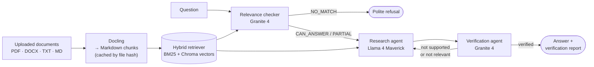
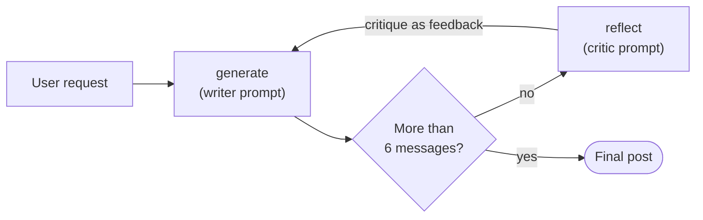

# 07 · Agentic AI with LangChain and LangGraph

[Course on Coursera](https://www.coursera.org/learn/agentic-ai-with-langchain-and-langgraph) · Status: 🟢 Done

## What I built

DocChat, a multi-agent RAG application that answers questions about uploaded documents and checks its own answers. One agent decides whether the documents can answer the question at all, a second writes the answer from retrieved passages, and a third verifies it against the sources and sends it back for another attempt if it is unsupported. Before that, I learned LangGraph's building blocks with stateful workflows and built a reflection agent that critiques and rewrites its own output.

## Architecture

**DocChat (final project)**

**Reflection agent**

## Projects & labs

| Project | What it does | Key techniques | Stack |
|---|---|---|---|
| LangGraph 101 | Login workflow with retry loop, QA workflow with an LLM node, counter graph | Typed state, nodes, edges, conditional edges, compiled graph | LangGraph, watsonx.ai (Llama 4 Maverick) |
| Reflection agent | Writes a LinkedIn post, critiques it and rewrites it in a loop | Generate–reflect loop, `MessageGraph`, message-count stop condition | LangGraph, LangChain (LCEL), Granite 4 |
| **DocChat (final project)** | Answers questions about uploaded documents and verifies each answer against the sources | Docling parsing, header-based chunking, hash-based cache, hybrid BM25 + vector retrieval, three specialized agents, verification loop | LangGraph, LangChain, ChromaDB, Docling, watsonx.ai (Granite 4, Llama 4 Maverick, Granite embeddings), Gradio |

## Results

- **DocChat:** the Gradio app shows each answer next to its verification report (supported, unsupported claims, contradictions, relevance), so the user can see how well the answer is backed by the documents.
- **Reflection agent:** after three rounds the post had a stronger opening and a call to action, but it still exceeded the requested 160 characters (216 → 221); the critic had wrongly praised the first draft for fitting the limit.
- **QA workflow:** off-topic questions get "I don't have enough context" instead of an invented answer.

## Key learnings

- Splitting a RAG system into specialized agents (relevance check → answer → verification) keeps each step simple, lets each use its own model and temperature, and gives the user a report on how much to trust the answer.
- Hybrid retrieval combines exact keyword matches (BM25) with semantic similarity (vectors); caching parsed documents by file hash avoids re-parsing on every question.
- Every loop in an agent graph needs an explicit stop condition: DocChat's retry after failed verification reuses the same documents and has no retry limit, so only the framework's recursion limit would end it. A counter in the state or a fresh retrieval would fix that.
- An LLM critic is not a reliable checker for hard constraints such as length; measurable rules belong in code.
- A LangGraph workflow is a state machine: nodes return partial updates, conditional edges choose the next step.
