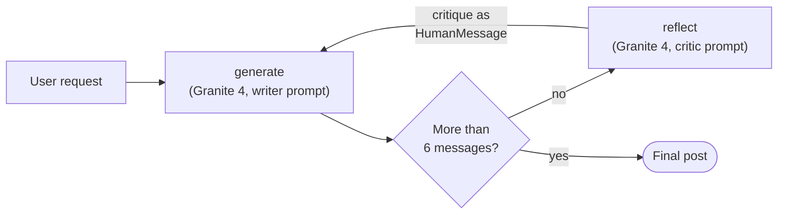
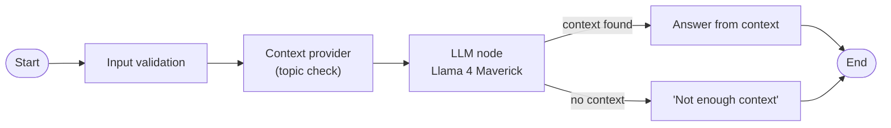

# 07 · Agentic AI with LangChain and LangGraph

[Course on Coursera](https://www.coursera.org/learn/agentic-ai-with-langchain-and-langgraph) · Status: 🟡 In progress (~42%)

## What I built

Stateful workflows and a self-improving agent with LangGraph. A login workflow loops back to the input step until the credentials are valid, and a question-answering workflow only calls the LLM when it has relevant context. A reflection agent then writes a LinkedIn post, critiques it in a second LLM role and rewrites it based on that critique over several rounds.

## Architecture

**Reflection agent**

**Question-answering workflow**

## Projects & labs

| Project | What it does | Key techniques | Stack |
|---|---|---|---|
| LangGraph 101 | Login workflow with retry loop, QA workflow with an LLM node, counter graph | Typed state (`TypedDict`), nodes, edges, conditional edges, compiled graph | LangGraph, watsonx.ai (Llama 4 Maverick) |
| **Reflection agent** | Writes a LinkedIn post, critiques it and rewrites it in a loop | Generate–reflect loop, `MessageGraph`, critique fed back as user feedback, message-count stop condition | LangGraph, LangChain (LCEL), watsonx.ai (Granite 4) |

## Results

- **QA workflow:** "What is the weather today?" → "I don't have enough context to answer your question."; "What is LangGraph?" → answer based on the provided context.
- **Login workflow:** wrong credentials route back to the input node; correct ones end with "Authentication successful".
- **Reflection agent:** after three rounds, the post had a stronger opening and a call to action. It still contained a placeholder link and, like the first draft, exceeded the requested 160 characters (216 → 221). The critic had wrongly praised the first draft for fitting the limit.

## Key learnings

- A LangGraph workflow is a state machine: each node returns only the fields it changes, and conditional edges decide the next step; a loop is just an edge back to an earlier node plus a stop condition.
- Placing validation and context nodes before the LLM decides when the model should answer at all, which reduces invented answers.
- Reflection improves style and structure, but an LLM critic is not a reliable checker for hard constraints such as length. Measurable rules belong in code, for example in the stop condition.
