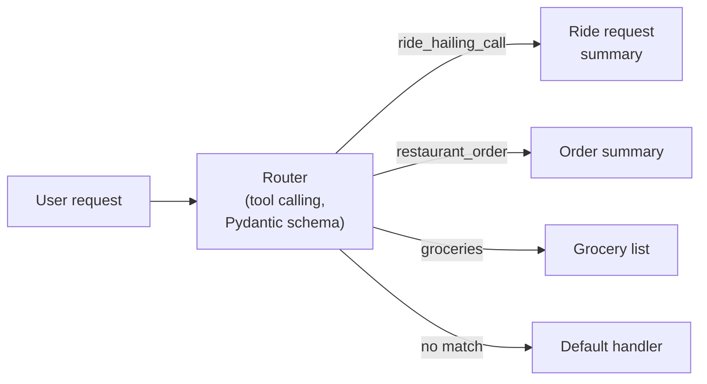
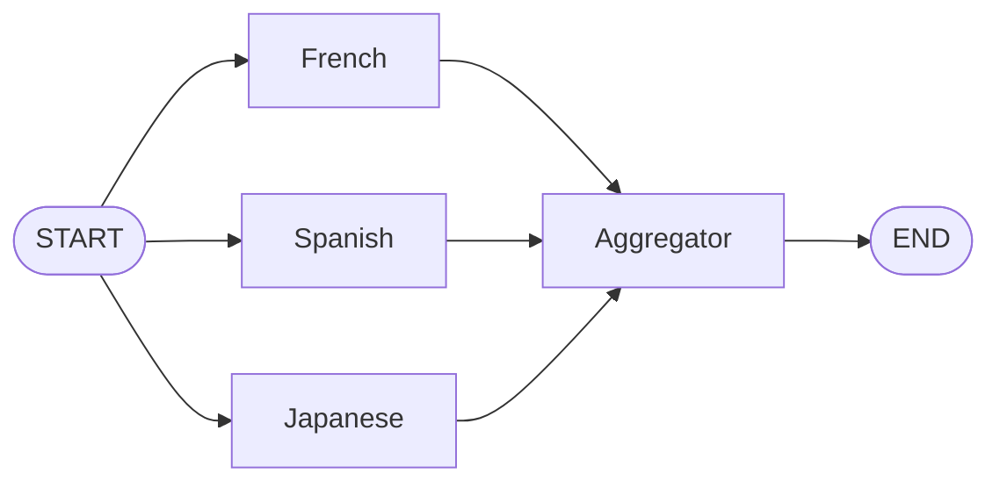

# 08 · Agentic AI with LangGraph, CrewAI, AutoGen and BeeAI

[Course on Coursera](https://www.coursera.org/learn/agentic-ai-with-langgraph-crewai-autogen-and-beeai) · Status: 🟡 In progress (~10%)

## What I built

The three core LLM workflow patterns as LangGraph graphs: a job application assistant that chains a resume summary into a cover letter, a router that sends each request to the right handler, and a translator that produces French, Spanish and Japanese versions in parallel. On top of that, a request router for a delivery-style app that uses tool calling to choose between ride hailing, restaurant orders, groceries and a fallback handler.

## Architecture

**Request router (exercise)**

**Parallelization**

## Projects & labs

| Project | What it does | Key techniques | Stack |
|---|---|---|---|
| **Workflow patterns** | Job application assistant (resume summary → cover letter), summarize/translate router, parallel translator | Prompt chaining, routing with conditional edges, parallel branches with an aggregator | LangGraph, LangChain, GPT-4o mini |
| **Request router** | Sends requests to ride-hailing, restaurant, grocery or fallback handlers | Tool-calling classifier with a Pydantic model, fallback route | LangGraph, LangChain, GPT-4o mini |

## Results

- **Request router:** all four test requests reached the right handler, including "What's the weather like today?" → fallback handler.
- **Parallel translator:** "Good morning! I hope you have a wonderful day." returned in French, Spanish and Japanese in one run.
- **Routing demo:** a translation request was classified correctly but produced no output, because the graph had been compiled before its conditional edges were added.

## Key learnings

- Three patterns cover most multi-step LLM workflows: chaining for dependent steps, routing for different request types, parallelization for independent subtasks.
- A router needs a fallback route; otherwise requests that fit no category have nowhere to go.
- Parallel branches should each write their own state field, so the aggregator can combine them without conflicts.
- A compiled LangGraph app is a snapshot: changes to nodes or edges only take effect after compiling again.
