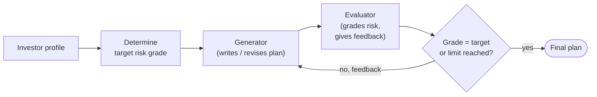
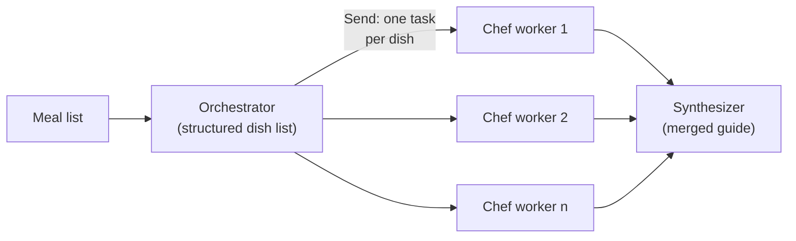
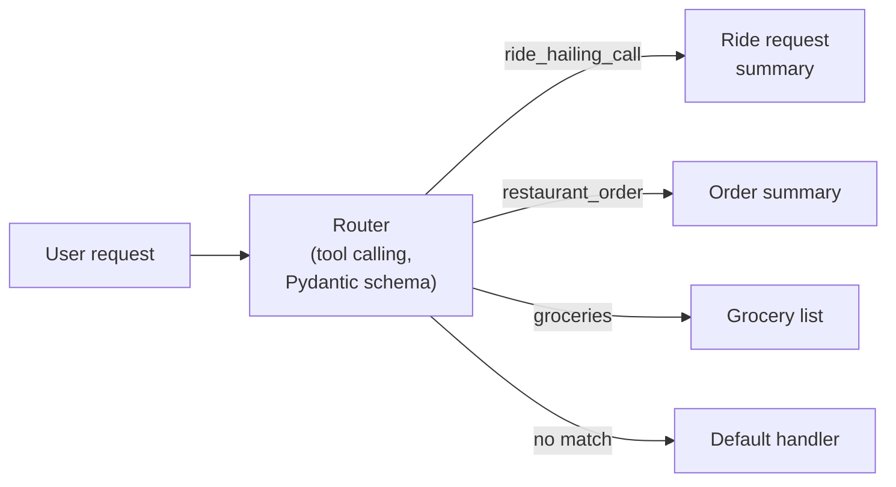

# 08 · Agentic AI with LangGraph, CrewAI, AutoGen and BeeAI

[Course on Coursera](https://www.coursera.org/learn/agentic-ai-with-langgraph-crewai-autogen-and-beeai) · Status: 🟡 In progress (~20%)

## What I built

The core LLM workflow patterns as LangGraph graphs. Basic patterns: a job application assistant that chains a resume summary into a cover letter, a router that sends each request to the right handler (ride hailing, restaurant orders, groceries or a fallback), and a translator that produces three languages in parallel. Advanced patterns: an orchestrator-worker meal planner that splits a meal list into dishes and starts one "chef" worker per dish, and an evaluator-optimizer loop in which one LLM role writes an investment plan and another grades its risk until it matches the investor's profile.

## Architecture

**Evaluator-optimizer (investment plan)**

**Orchestrator-worker (meal guide)**

**Request router**

## Projects & labs

| Project | What it does | Key techniques | Stack |
|---|---|---|---|
| Workflow patterns | Job application assistant, summarize/translate router, parallel translator | Prompt chaining, routing with conditional edges, parallel branches with an aggregator | LangGraph, LangChain, GPT-4o mini |
| Request router | Sends requests to ride-hailing, restaurant, grocery or fallback handlers | Tool-calling classifier with a Pydantic model, fallback route | LangGraph, LangChain, GPT-4o mini |
| **Meal guide (orchestrator-worker)** | Splits a meal list into dishes and writes a cooking guide per dish | Structured output, dynamic fan-out with the `Send` API, reducer to collect results, synthesizer | LangGraph, LangChain, GPT-4o mini |
| **Investment plan optimizer** | Writes an investment plan and revises it until its risk grade matches the investor profile | Evaluator-optimizer loop, structured grading, feedback-driven regeneration, iteration limit | LangGraph, LangChain, GPT-4o mini |
| **Research & content crew** | A researcher agent searches the web, a writer agent turns the findings into a blog post, a social media agent writes short posts | CrewAI agents (role, goal, backstory), sequential tasks, web search tool, token usage tracking | CrewAI, Serper, watsonx.ai (Llama 4 Maverick) |

## Results

- **Investment plan optimizer:** target grade "aggressive" for a 29-year-old high-risk investor. The grade swung from "high risk" to "moderate" and back before matching "aggressive" in the 6th evaluation, the last one the iteration limit allowed.
- **Meal guide:** the planner and the chef workers were tested step by step (for example, a Spaghetti Bolognese walkthrough from an "Italian chef" worker).
- **Request router:** all four test requests reached the right handler, including "What's the weather like today?" → fallback handler.
- **Parallel translator:** one sentence returned in French, Spanish and Japanese in a single run.
- **Research & content crew:** produced a blog post on generative AI adoption with sourced figures. The two-agent run used about 106,000 tokens, roughly 90 % of them input (instructions, search results, previous task output).

## Key learnings

- Basic patterns cover most multi-step workflows: chaining for dependent steps, routing for different request types, parallelization for independent subtasks.
- The `Send` API makes fan-out dynamic: the number of workers depends on the data, not on the graph definition.
- In an evaluator-optimizer loop, feedback can overcorrect and make the result oscillate around the target; an explicit iteration limit is what guarantees the loop ends.
- A router needs a fallback route, and a compiled LangGraph app is a snapshot: changes only take effect after compiling again.
- In CrewAI, sequential tasks hand their output to the next agent as context; that is convenient but makes token costs grow with every step.
