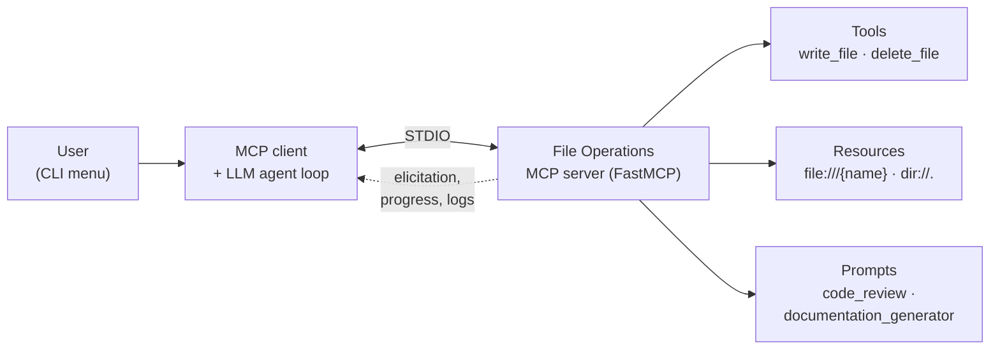
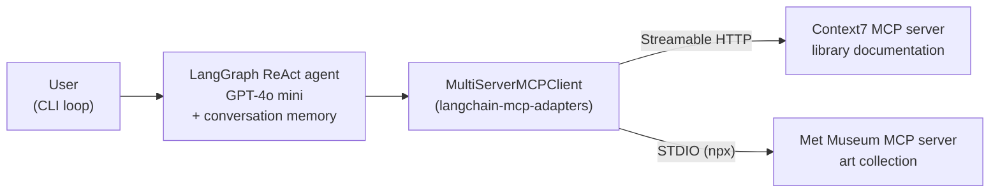

# 09 · Build AI Agents using MCP

[Course on Coursera](https://www.coursera.org/learn/build-ai-agents-using-mcp) · Status: 🟡 In progress (~70%)

## What I built

My own MCP server for file operations, with all three MCP building blocks: tools that write and delete files, resources that read files and list the directory, and prompts for code review and documentation generation. The server can ask the user for missing input mid-request and reports progress while writing. A matching command-line client connects an LLM to it. I also wrote a minimal MCP client with the low-level MCP Python SDK that manages the session itself and calls a server's tools, resources and prompts from a command line. Earlier in the course, I built a CLI assistant whose agent uses tools from two existing MCP servers at once (Context7 library documentation and the Met Museum collection), and a Python client that talks to an MCP server over both STDIO and Streamable HTTP.

## Architecture

**File operations MCP server and client**

**MCP application (multi-server agent)**

## Projects & labs

| Project | What it does | Key techniques | Stack |
|---|---|---|---|
| Run existing MCP servers | Finds a library's documentation through the Context7 MCP server (e.g. FastMCP, scikit-learn) | Tool discovery (`list_tools`), tool calls with JSON schemas, STDIO and Streamable HTTP transports | FastMCP, Context7 |
| **Multi-server MCP assistant** | CLI assistant that answers questions about library documentation and the Met Museum collection | Multi-server MCP client, MCP tools as LangChain tools, ReAct agent with session memory, mixed STDIO and HTTP servers | LangGraph, langchain-mcp-adapters, GPT-4o mini |
| **File operations MCP server** | Lets an LLM write, delete, read and list files, review code and generate documentation through MCP | Tools, resources and resource templates, prompts, elicitation with a Pydantic schema, progress reporting, path restriction to the project directory | FastMCP, Pydantic, LLM via API |
| Custom MCP client | Command-line client that lists and calls a server's tools, reads files through a resource template and renders prompts | `ClientSession` over STDIO, session lifecycle with `AsyncExitStack`, JSON arguments with error handling, operation history | MCP Python SDK, FastMCP |

## Results

- Listed the Context7 server's two tools with their descriptions and input schemas.
- Resolved "scikit-learn" to the library ID `/scikit-learn/scikit-learn` and fetched its documentation; the same flow worked for FastMCP over both transports.
- **Custom MCP client:** a `write_file` call through the client created a new file on the server side, and a file I added to the resources folder was readable right away through the existing resource template.

## Key learnings

- An MCP server offers three kinds of capabilities: tools act (write, delete), resources only provide data (read, list), and prompts package reusable workflows for the model.
- Servers can talk back during a request: progress updates, log messages and elicitation, which asks the user for missing input instead of failing or guessing.
- A server that touches the file system must restrict every path to an allowed directory.
- An MCP server describes its own tools (name, description, JSON input schema), so any client or agent can discover and call them; the transport (STDIO or Streamable HTTP) is interchangeable.
- Adding a capability to an agent means adding a server entry: the adapter turns every server's tools into agent tools, and local and remote servers can be mixed in one client.
- A low-level client owns the session lifecycle: connect, initialize, use, and always close the connection, even after an error.
