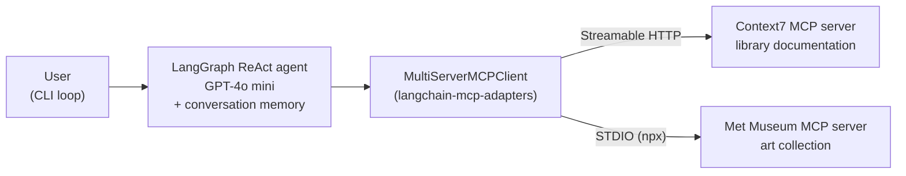
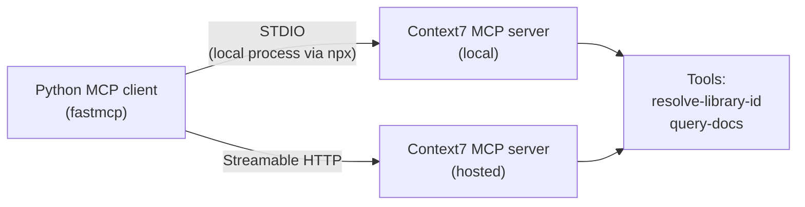

# 09 · Build AI Agents using MCP

[Course on Coursera](https://www.coursera.org/learn/build-ai-agents-using-mcp) · Status: 🟡 In progress (~30%)

## What I built

A command-line AI assistant whose agent gets its tools from two Model Context Protocol (MCP) servers at once: Context7 for up-to-date documentation of programming libraries and the Metropolitan Museum of Art collection. Before that, I wrote a Python MCP client that discovers and calls the tools of an existing server, first over a local STDIO connection and then over Streamable HTTP.

## Architecture

**MCP application (multi-server agent)**

**MCP client with two transports**

## Projects & labs

| Project | What it does | Key techniques | Stack |
|---|---|---|---|
| Run existing MCP servers | Finds a library's documentation through the Context7 MCP server (e.g. FastMCP, scikit-learn) | Tool discovery (`list_tools`), tool calls with JSON schemas, STDIO and Streamable HTTP transports | FastMCP, Context7 |
| **Multi-server MCP assistant** | CLI assistant that answers questions about library documentation and the Met Museum collection | Multi-server MCP client, MCP tools as LangChain tools, ReAct agent with session memory, mixed STDIO and HTTP servers | LangGraph, langchain-mcp-adapters, GPT-4o mini |

## Results

- Listed the Context7 server's two tools with their descriptions and input schemas.
- Resolved "scikit-learn" to the library ID `/scikit-learn/scikit-learn` and fetched its documentation; the same flow worked for FastMCP over both transports.

## Key learnings

- An MCP server describes its own tools (name, description, JSON input schema), so any client or agent can discover and call them without custom integration code.
- The transport is interchangeable: STDIO runs the server as a local process, Streamable HTTP talks to a remote server, and the client code stays the same.
- Adding a capability to an agent means adding a server entry: the adapter turns every server's tools into agent tools, and local and remote servers can be mixed in one client.
- Tool descriptions are written for the model: Context7's tools tell the agent which tool to call first and how often.
