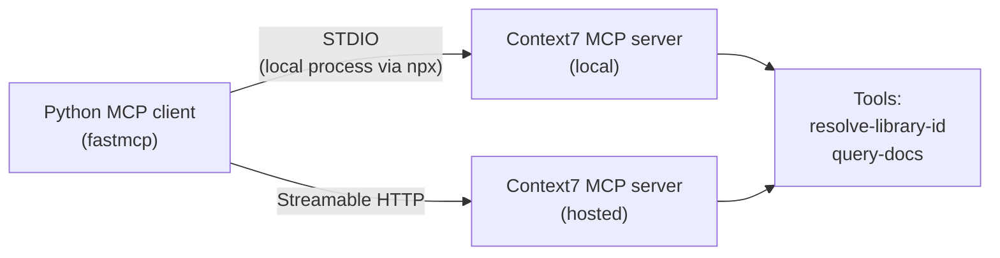

# 09 · Build AI Agents using MCP

[Course on Coursera](https://www.coursera.org/learn/build-ai-agents-using-mcp) · Status: 🟡 In progress (~15%)

## What I built

A Python client for the Model Context Protocol (MCP) that connects to an existing MCP server, Context7, which serves up-to-date documentation for programming libraries. The client discovers the server's tools at runtime and calls them, first over a local STDIO connection and then over Streamable HTTP to the hosted server, with the same client code.

## Architecture

## Projects & labs

| Project | What it does | Key techniques | Stack |
|---|---|---|---|
| **Run existing MCP servers** | Finds a library's documentation through the Context7 MCP server (e.g. FastMCP, scikit-learn) | Tool discovery (`list_tools`), tool calls with JSON schemas, STDIO and Streamable HTTP transports | FastMCP, Context7 |

## Results

- Listed the server's two tools with their descriptions and input schemas.
- Resolved "scikit-learn" to the library ID `/scikit-learn/scikit-learn` and fetched its documentation; the same flow worked for FastMCP over both transports.

## Key learnings

- An MCP server describes its own tools (name, description, JSON input schema), so any client or agent can discover and call them without custom integration code.
- The transport is interchangeable: STDIO runs the server as a local process, Streamable HTTP talks to a remote server, and the client code stays the same.
- Tool descriptions are written for the model: Context7's tools tell the agent which tool to call first and how often.
