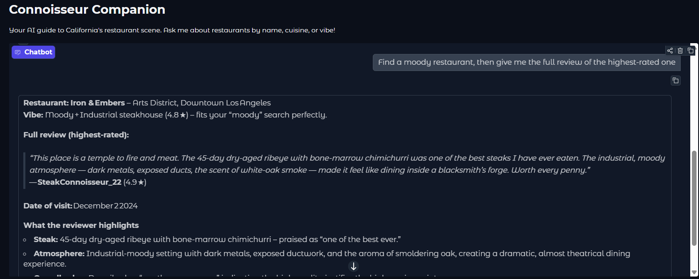
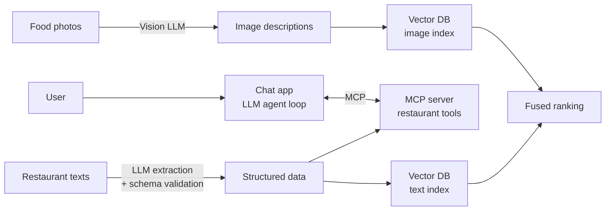
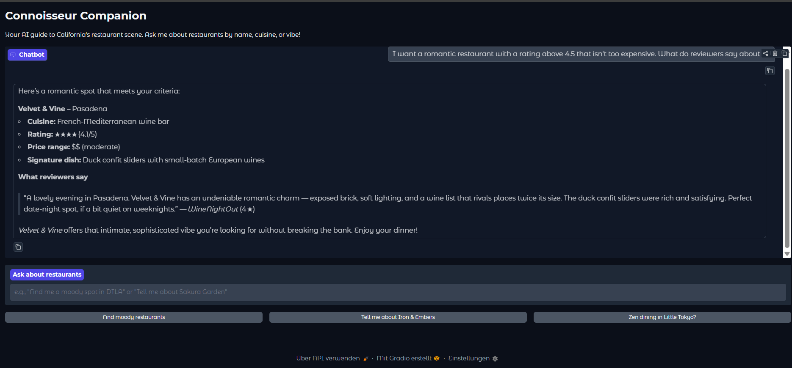

# 10 · RAG and Agentic AI Capstone Project

[Course on Coursera](https://www.coursera.org/learn/rag-and-agentic-ai-capstone-project) · Status: 🟡 In progress (~95%)

## What I built

**Connoisseur Companion**, a food recommendation assistant for California restaurants and recipes, built end to end in four stages:

1. **Data:** an LLM turned 210 free-text restaurant descriptions into validated JSON records, and a vision LLM described 109 recipe photos and user review photos.
2. **Retrieval:** a multimodal vector index (text and images) with metadata filters and a fused text + image ranking.
3. **Agents:** six specialized agents (user profile, retrieval, food trends, food style, nutrition, final recommendation) in one workflow, plus a chatbot that detects the request type and extracts preferences.
4. **MCP application:** an MCP server with restaurant tools and a chat app in which an LLM decides which tools to call.

## Architecture

## Projects & labs

| Stage | What it does | Key techniques | Stack |
|---|---|---|---|
| Data structuring | Restaurant texts → validated JSON records | Extraction prompt, Pydantic schema, LLM-based JSON repair loop | watsonx.ai (Granite 4), Pydantic |
| Image descriptions | Recipe and review photos → text descriptions | Vision LLM, review text as context, download retries | watsonx.ai (Llama 4 Maverick) |
| Data management CLI | Browse, add, edit and delete records | Confirmation before writes, LLM structuring of new entries, unit tests | Python, unittest |
| **Multimodal retrieval** | Find restaurants by text and dishes by image or text | Text and image embeddings, metadata filters, weighted fusion and re-ranking | ChromaDB, sentence-transformers, CLIP |
| **Multi-agent recommender** | Builds a user profile and turns it into restaurant and recipe recommendations | Role-based agents, shared state, parallel analysis agents, synthesis step | OpenAI API, LangChain |
| Recommendation chatbot | Chat UI that understands what the user wants | Intent classification, preference extraction as JSON | Gradio, watsonx.ai (Granite 4) |
| **Connoisseur Companion** | Chat app that answers restaurant questions through MCP tools | MCP server (tools + resource), client with roots and sampling, ReAct tool loop | FastMCP, MCP Python SDK, Gradio, watsonx.ai (Granite 4) |

## Results

- **Data:** all 210 restaurants were extracted and validated; 109 recipes and 10 reviews got image descriptions.
- **Retrieval:** "cozy restaurant with noodles" returned four noodle and ramen places. In the fused ranking for "fresh sushi", the image-heavy setting put *Lemon Ricotta Pancakes* first, because the best image always gets the top score, even when no image matches.
- **Multi-agent recommender:** two test users (vegan, adventurous foodie) each got 5 restaurant and 5 recipe recommendations; for the vegan user, the first one was a place they had already visited 8 times.
- **Connoisseur Companion:** multi-step questions worked ("find a moody restaurant, then show the review of the highest-rated one"). For "rating above 4.5, not too expensive", it recommended a restaurant rated 4.1.

  

## Key learnings

- LLM + schema validation + repair loop is a reliable way to turn unstructured text into data, but the loop needs a retry limit and field quality still needs checks.
- Multimodal fusion needs normalization *and* a relevance threshold; otherwise the "best of a bad set" wins.
- A multi-agent workflow is only as good as its data access: simulated retrieval and mock results look convincing but are not grounded in the real data.
- With MCP, hard constraints like rating or price must be tool parameters; if only the prompt mentions them, the LLM may ignore them.
